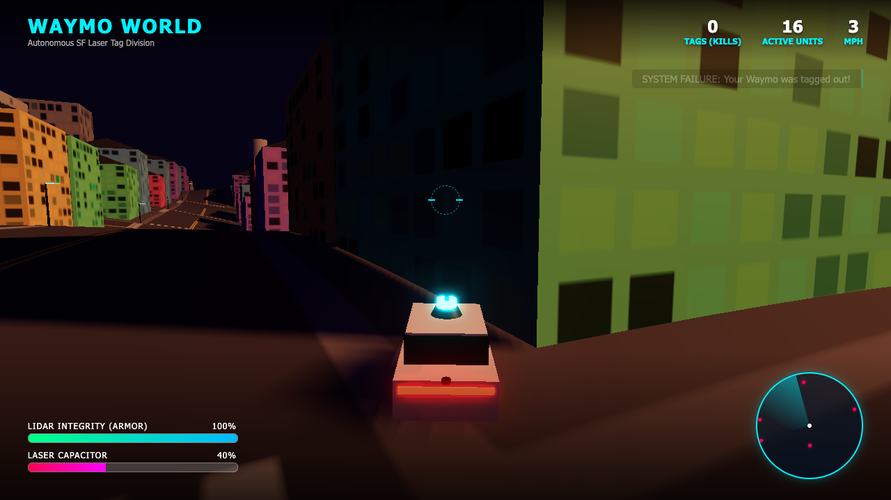

# SF Laser Taxi

A multiplayer browser game: players drive robotaxis around San Francisco and shoot lasers at each other.

## Status

- **Frontend** (`index.html` + `js/`): multiplayer game, rendered with Babylon.js 8.56.2 and CC0 Poly Haven assets. A start modal asks for a username; a leaderboard (top right) shows players online and kill counts. Every other car is a real player (the old single-player bots were removed).
- **Backend** (`backend/`): WebSocket game server. Tracks players, broadcasts 20 Hz position snapshots, validates hits, and owns HP / kills / deaths.

## Deployments (Render)

| Part     | URL                                       |
| -------- | ----------------------------------------- |
| Frontend | https://waymoworld.onrender.com/          |
| Backend  | https://waymoworld-server.onrender.com    |

- WebSocket endpoint: `wss://waymoworld-server.onrender.com/ws`
- Health check: `https://waymoworld-server.onrender.com/health` returns `{ ok, clients, players }`
- Debug dashboard: `https://waymoworld-server.onrender.com/?token=<DEBUG_TOKEN>` (see below)

## Layout

```
index.html          # Frontend page: HUD, start modal, loads Babylon.js 8.56.2 from jsDelivr and js/main.js
js/                 # Frontend ES modules (see "Frontend" below)
assets/             # CC0 Poly Haven textures, models and HDRI sky (committed; scripts/fetch_assets.py re-downloads them)
scripts/babylon_probe.py  # headless GPU check of the frontend (see "Frontend: Testing")
backend/
  package.json      # Node >= 20, ESM, sole dependency: ws
  src/server.js     # HTTP server (/health, / dashboard, /debug/*) + WebSocketServer on /ws, player registry, 20 Hz snapshots, hit validation, 30s ping/pong heartbeat
  src/debug.html    # Debug dashboard page served at / (and /debug)
```

## Running locally

Frontend: serve the root folder with any static server:

```sh
python3 -m http.server 8000         # or: npx serve .
```

Then open http://localhost:8000/ (add `?q=ultra` for top graphics). Opening `index.html` straight from disk
(`file://`) doesn't work: browsers block the ES modules and texture loads. Without the backend running the page
sits on "connecting…" but you can still drive around. Hard-refresh (Cmd+Shift+R) after pulling changes.

The Render static site needs no build step: it publishes the repo root as-is, `assets/` included.

Backend:

```sh
cd backend
npm install
npm run dev      # node --watch; listens on $PORT or 8080
```

Local WebSocket URL: `ws://localhost:8080/ws`

The frontend picks its server automatically: `ws://localhost:8080/ws` when served from `localhost` / `127.0.0.1` / `file://`, otherwise `wss://waymoworld-server.onrender.com/ws`. Override with `?server=ws://host:port/ws`.

To test multiplayer locally, open the page in two browser windows.

## Debug dashboard

The dashboard at `/` (also `/debug`) is a live view of all server state. It polls `/debug/state` (JSON) every 0.25 to 5 s and shows:
- an overview: uptime, sockets, players, spectators, message rates, memory
- a top-down map of players with heading, HP, and hit range
- every player field (position, HP, live shots, spawn protection, how long since their last state update)
- every socket (IP, user agent, message counts, send buffer)
- counters, including messages by type and shots or hits rejected by reason
- config, a log of the last 200 events (connect, join, hit, hit-rejected, kill, leave, …), and the raw JSON

- a **Daily users** line chart (14 to 365 days, from `/debug/dau?days=N`): **DAU** = total `join`s that day, **uDAU** = distinct players who joined. Players are identified by a random browser ID the client keeps in localStorage (`sflasertaxi-cid`, sent as `cid` in `join`), or by IP when the client doesn't send one. Days roll over at midnight America/Los_Angeles.

**Persistence:** when `DATABASE_URL` is set (it is on Render), counters, `nextId`, the event log (kept 30 days), and daily-user rows are stored in Postgres and restored on startup. Tables are created automatically (`server_stats`, `events`, `daily_users`). Without `DATABASE_URL` (local dev), everything stays in memory. If the database can't be reached at startup, the server still runs, in memory only, and the dashboard's `database` card shows `FAILED`.

Access: with no `DEBUG_TOKEN` env var set, it only answers direct localhost requests (`http://localhost:8080/`). On Render, set `DEBUG_TOKEN` in the service's environment and open `/?token=<value>`. The page includes player IPs, so keep the token private.

## Multiplayer model

- **Each client owns its own car's movement** and sends `state` 20×/s. The server clamps it to the world bounds and rebroadcasts everyone in `snap`.
- **Remote cars** ease toward the latest snapshot, extrapolating with `speed` for up to 250 ms; a jump of more than 40 units snaps (respawn).
- **Hits are detected by the shooter's client** (its own lasers vs. remote cars) and reported as `hit`. The server rejects a hit if there's no unspent shot from the last 2 s, the target is more than 320 units away, or the target is within 2 s of (re)spawning. Otherwise it applies 25 damage.
- **5 server-driven bots** (`BOT_NAMES` in `backend/src/server.js`) are always in the game. They use the same entity shape as players (`bot: true` in `welcome`/`join`), so snapshots, the leaderboard, and hits treat them the same. Bots drive intersection to intersection along street centerlines (`x, z = -585 + 100k`, which have no collision boxes), mostly toward the nearest human. They only fire straight down their own street, since that's guaranteed line of sight. The server can't see lasers, so the **victim's client** reports a bot laser hitting it with `botHit`, which goes through the same validation as `hit`. The server keeps its own copy of `getElevation()` for bot laser origins and aim, and it must match `js/shared.js` exactly.
- **The server owns HP, kills, and deaths.** At 0 HP it broadcasts `kill`, resets the victim to 100 HP, and heals the killer by 25. The victim's client picks a new random spawn point.
- **The city is generated with a seeded RNG** (`cityRandom`, seed 415), so building heights, and therefore laser collisions, match on every client. Facade textures and other cosmetic detail use their own fixed seeds, so every client also sees the same city.
- Clients on the start modal are connected but not joined: they receive all broadcasts (remote cars drive around behind the modal), but aren't in the roster.

## Message protocol

All messages are JSON with a `type` field. Tuning constants are at the top of `backend/src/server.js`; keep them in sync with `js/shared.js` and `js/game.js`.

Client → server:

| type | fields | notes |
|---|---|---|
| `join` | `name` | sent on Start; name is sanitized to ≤16 chars of letters, digits, space, `_.-` (default `USER-<id>`, zero-padded) |
| `state` | `x, z, a, s` | position, heading (rad), speed; 20 Hz |
| `shoot` | `p: [x,y,z], d: [x,y,z]` | laser origin and direction; server cooldown 150 ms |
| `hit` | `target` | id of the remote player or bot your laser hit |
| `botHit` | `bot` | a bot's laser hit your car (bots can't detect hits themselves) |

Server → client:

| type | fields | notes |
|---|---|---|
| `welcome` | `players: [{id,name,kills,deaths,x,z,a,s,hp,bot}]` | on connect; includes bots |
| `joined` | `id, name` | reply to your `join` (with the sanitized name) |
| `join` / `leave` | `player` / `id` | broadcast to everyone, including the joiner |
| `snap` | `p: [[id,x,z,a,s,hp], ...]` | 20 Hz, all joined players and bots; sent whenever any socket is connected |
| `shoot` | `id, p, d` | to everyone except the shooter |
| `hp` | `id, hp, by?` | after damage or the kill heal |
| `kill` | `killer, victim, killerKills, victimDeaths` | |
| `error` | `error` | e.g. invalid JSON |

## Frontend (Babylon.js): handoff notes

This section is written so a new contributor (human or AI) can keep upgrading the graphics without
re-discovering everything. Read "World contract" and "Conventions" before changing geometry or physics.

### Quick facts

- **Engine:** Babylon.js **8.56.2** (UMD build + glTF loaders from jsDelivr, pinned in `index.html`). Code is plain
  ES modules in `js/` using the global `BABYLON`; no bundler, no npm.
- **Coordinates:** `scene.useRightHandedSystem = true`, y up, cars on the x–z plane, heading `a` means forward
  `(sin a, 0, cos a)`. North is **−z** (Golden Gate Bridge at z = −705), the bay is east (**x > 395**, the drivable
  limit `SHORE_X`), Ocean Beach is west (x < −600). 1 unit ≈ 1 m (the taxi is 4.8 long).
- **Assets:** CC0 Poly Haven files, committed in `assets/` (~45 MB). `scripts/fetch_assets.py` (stdlib only)
  re-downloads them; to add or swap an asset, edit its `TEXTURES` / `MODELS` / `HDRIS` lists and re-run it.
  If an asset is missing the game still boots: images become plain surfaces, PBR maps become flat maps, and a
  missing HDRI falls back to a flat sky plus a hemispheric fill light (`noHdri()` in `main.js`).
- **Debug handle:** `window.__sflt = { G, scene, engine, pipelines, downgrade }` in the browser console.
- **URL flags:** `?q=ultra|high|low` (graphics tier; also on the start screen, saved in localStorage
  `sflt-quality`), `?touch=1|0` (force phone controls), `?ssao=1` (try SSAO, see known issues),
  `?revdepth=1` (reverse depth buffer), `?server=ws://…` (WebSocket server).

### Module map

| File | What it owns |
|---|---|
| `js/shared.js` | **World contract**: grid constants, `getElevation()`, `mulberry32`, `isInsideRoadway`, and the shared mutable state object `G` |
| `js/main.js` | Boot sequence, engine/scene, HDRI sky + IBL, sun + cascaded shadows, glow layer, post-processing pipelines and quality tiers, game loop, chase camera, menu orbit camera, dynamic resolution watchdog, `startGame()` |
| `js/materials.js` | Texture loading (with progress), Poly Haven PBR materials (`phMaterial`), **procedurally painted facade atlases** (Victorian, 4 downtown styles, storefronts), water normal map, leaf/frond cards, solid materials |
| `js/geo.js` | `GeometryBatch`: accumulates triangles per material, builds merged meshes, splits them into 300 m chunks |
| `js/city.js` | Terrain, shore aprons, sidewalks + curbs, road paint, every building, every landmark, parks, beach, water; also collects street-prop positions |
| `js/props.js` | Trees / palms / cypresses (thin instances), traffic signals with live phases, parked cars, Poly Haven lamps + utility boxes (glTF instances with LOD), cable cars |
| `js/car.js` | The procedural robotaxi (lofted body, greenhouse, wheels, sensor dome, decals) and parked-car templates |
| `js/game.js` | `Vehicle` (physics, collisions, network smoothing), `Laser`, particles, explosions, the fixed light pool |
| `js/net.js` | WebSocket client: roster, snapshots, shots, hits, kills (protocol in "Message protocol" above) |
| `js/hud.js` | HUD, leaderboard, kill feed, minimap, floating name tags, keyboard + touch input |
| `js/sound.js` | Web Audio synth sounds |

Boot order (`main()` in `main.js`): engine → scene → lighting (HDRI, sun, CSM, glow) → `createMaterials()`
(awaits the facade source images) → `buildCity()` → `buildProps()` (awaits glTF) → cable cars → `initFx()`
(laser templates, particle textures, light pool) → minimap → `createPipelines()` → player → input → `connect()`
→ render loop. `scene.executeWhenReady` adds `body.ready` and enables Start. All per-frame logic is one
`scene.onBeforeRenderObservable` callback in `main.js`.

### World contract (don't break multiplayer)

Other clients and the server assume these exact values. Change them only together with `backend/src/server.js`.

- `getElevation()` in `js/shared.js` must match the server's copy (bot laser origins and aim use it).
- Grid: `GRID_STEPS 12`, `BLOCK_SIZE 70`, `STREET_WIDTH 30`, `CELL_SIZE 100`, `OFFSET 600`. Bots drive the street
  centre lines `x, z = −585 + 100k`, which must stay free of collision boxes.
- **`G.buildings` (collision AABBs) must keep the same values and order.** `buildCity()` replays the original
  generator call-for-call with `cityRandom = mulberry32(415)`: Transamerica (gx 7, gz 6) and Coit Tower (4, 7) consume
  no randoms and `continue`; Golden Gate Park blocks consume 8; downtown blocks (gx ≥ 6, gz 4–8) consume 2 (height,
  style) and push a 54 × 54 box, Salesforce (7, 5) included; every other block is four 27 × 27 houses consuming 2 each.
  Visual detail is free to change; **never add or remove `cityRandom()` calls**. Use the cosmetic RNG (`rnd`, seed
  2718) or a new `mulberry32` for anything visual.
- Vehicle tuning (`maxSpeed 72`, `accel 64`, `handling 2.85`, friction `0.45^dt`, boost ×1.38), collision radii
  (2.75 test / 2.85 push-out), laser speed 240 and life 1.15 s, aim-assist cone 0.30 rad / 140 units, fire cooldown
  0.22 s / 14 energy, and spawn protection 2 s are all carried over from the original game. Hits are client-detected,
  so changing them changes the game for everyone.
- `G.obstacles` (parked cars) is **local only**: they block your own car and your own lasers, but other clients
  don't know about them.

### Conventions and gotchas

- **Winding.** Babylon front faces are clockwise even in right-handed mode. `GeometryBatch.quad(a, b, c, d)` /
  `tri(a, b, c)` take vertices **counter-clockwise as seen from outside** and flip the indices internally; the
  normal comes from the right-hand rule. `wall(x0, z0, x1, z1, …)` faces to the **right of travel** (walking +x it
  faces +z). `lathe(rings)` needs each ring traced with **decreasing angle** (`x = cos(−t)`, `z = sin(−t)`) to face
  outward. `box(…, { rotY })` maps local x to `(cos r, 0, −sin r)`.
- **UVs are in world units divided by the tile size**, so textures keep their real scale on any wall. `vOrigin`
  sets where v = 0 sits (house floors line up with the ground at the house centre).
- **Trim band.** Every facade atlas reserves its bottom rows (v below about 0.02) as solid trim colour, and
  Victorians also have an accent stripe. Cornices, bay-window caps, brackets, doors and stoops use
  `box(…, { fixedUV: [0.5, TRIM_V] })` or `ACCENT_V`, so they share the wall's material and draw call. A new atlas
  must keep this band.
- **Facade maps** are canvases: albedo (sRGB), a height canvas turned into an OpenGL-convention normal map by
  `heightToNormal()`, and ARM (R = AO, G = roughness, B = metallic; linear). Glass is roughness 0.03–0.06 with some
  metalness so it mirrors the HDRI; `paintGlass()` varies interiors (blinds, curtains, dark rooms) so reflections
  break up. Canvases go through `canvasTexture()` (DynamicTexture, `update(true)` = canvas top is v = 1).
- **Chunking.** City batches are created with `{ chunked: true }`: geometry is split into 300 m tiles (keyed by
  each primitive's first vertex), so the camera and each shadow cascade frustum-cull the city. `build()` returns
  an **array** for chunked batches and a **single mesh** otherwise. Keep templates (anything built at the origin and
  instanced) unchunked, or they get split at x = 0 / z = 0.
- **Instancing rules learned the hard way:**
  - An `InstancedMesh` source must stay **enabled**: a disabled source hides all its instances. The laser templates
    are parked at y = −5000 instead of being disabled.
  - **Thin-instance buffers live on the geometry.** Clones share geometry, so each tree chunk calls
    `makeGeometryUnique()` before `thinInstanceSetBuffer()`. Without it you get
    `GL_INVALID_OPERATION: glDrawElementsInstanced: Vertex buffer is not big enough`.
  - High-poly scanned models (the lamp is about 30k triangles) use `InstancedMesh` + `addLODLevel(distance, null)`,
    so far instances aren't drawn at all.
- **Lights are created once.** Adding a light later forces every material to recompile (a visible hitch). The pool
  is the sun, 2 laser lights that follow the newest lasers, and 1 explosion flash (`initFx()` in `game.js`):
  4 lights, Babylon's default `maxSimultaneousLights`. Reuse them; don't `new PointLight` per event.
- **Glow layer is include-only.** `G.glow.addIncludedOnlyMesh()` is called for laser cores and halos, taxi bodies
  and lidar heads, signal lenses and beacons. Anything new that should glow must be added; an empty include list
  would make *everything* render into the glow pass (that cost about 3 ms).
- **Sun direction** comes from the HDRI's first-order spherical harmonics (`env.sphericalPolynomial.x / .z`, which
  are **Vector3s with r, g, b in x, y, z**, not Color3; reading `.r` gave NaN and no sunlight), with elevation fixed to
  the measured 48°. If you swap the HDRI, re-measure its sun elevation (brightest pixel row) and update it.
- **Taxi parts are found by name.** `spawnTaxiMesh()` in `game.js` clones the template and looks up nodes whose names
  end in `steer` (front/rear wheel pivots), `turret` (spinning lidar), `Body` and `lidarHead` (glow). Keep those
  names if you rebuild the car.

### Rendering pipeline and quality tiers

| Tier | Pixel density cap | Shadows (CSM) | MSAA | SSR | Default for |
|---|---|---|---|---|---|
| `ultra` | 1.5× | 3 cascades × 2048, PCF high, 420 m | 4× | on (half-res) | desktop |
| `high` | 1.25× | 3 × 2048, 420 m | 4× | off | |
| `low` | 1.0× | 2 × 1024, PCF low, 240 m | FXAA | off | touch devices |

- **Lighting:** `kloofendal_48d_partly_cloudy_puresky` HDRI as both the skybox (1024 cube) and IBL (256,
  prefiltered, `environmentIntensity 0.85`); directional sun at intensity 3.4, slightly warm.
- **Post** (`createPipelines()`): `DefaultRenderingPipeline` in HDR with ACES tone mapping (exposure 1.15,
  contrast 1.12, colour-curves saturation +22 so ACES doesn't grey the paint out), bloom (threshold 0.92, weight
  0.22), sharpen (not on low), vignette (stronger while boosting).
  SSR on ultra: strength 0.85, max distance 320, roughness factor 0.15, Fresnel, screen-border attenuation.
  Keep `blurDispersionStrength` at 0: any dispersion blur smears a hard-edged dark disc across the sky.
- **Camera:** chase camera 10.5 back / 4.2 up (pulls back slightly with speed), pushed out of buildings, FOV widens
  with speed and boost, wider base FOV in portrait, shake on hits and nearby kills.
- **Dynamic resolution** (watchdog in `main()`): every 2 s of play, if average fps < 45 it first disposes SSR
  (toast), then raises the hardware scaling level by 12% per step down to 0.7× CSS resolution; above 58 fps it
  steps back toward the tier's density. `G` while playing calls `downgrade()` once manually.

Measured on an Apple M2 at 960×540, headless (ANGLE/Metal), Ultra, 5 bots on screen:

| | before optimisation | after |
|---|---|---|
| fps | 37 | 53 |
| GPU ms / frame | 25.5 | 18.6 |
| draw calls | 5,900 | 4,000 |
| SSR cost | 7.5 ms | ~4 ms |
| shadow cost | 6.5 ms | ~5.4 ms |
| glow cost | 5.5 ms | ~3 ms |

The scene is GPU-bound (CPU render time ~5 ms), mostly fill and shadow passes. What got it there: include-only glow,
taxis merged from about 60 meshes to 6 (body + 4 wheels + lidar head), 3 cascades instead of 4, chunked city geometry
and tree instances. On a Retina screen expect Ultra to drop SSR and some resolution within seconds; that's the
watchdog working.

### What's built, where

- **Terrain and streets (`city.js`):** asphalt terrain in 4 × 4 tiles with vertex-colour patching; 18 cm sidewalks
  with curbs draped on the hills; road paint (double yellow, dashed lanes, parking lines, stop bars, continental
  crosswalks, cable-car rails on Powell x = −185 and California x = 115) as draped strips with `zOffset −2`; shore
  aprons north and south; Ocean Beach slope with wet sand and a foam line; one big water plane at y = −2.2 with a
  scrolling procedural normal map.
- **Victorian rows (`buildVictorian`):** 10 palettes (`VICTORIAN_PALETTES`): 0–5 saturated Painted Ladies clapboard,
  6–9 Outer Sunset pastel stucco with bold mustard / coral / teal doors and trim. The siding photos are turned into
  neutral, light greyscale detail (`detailImage()`) before the paint is multiplied in, so colours stay clean instead
  of going muddy. Visible wall height
  snapped to whole floors; two three-sided bay windows per street face; cornice ring with brackets; front door with
  stoop; 45% hip roofs (shingle), the rest Italianate flat roofs with parapets; the Painted Ladies block (gx 4, gz 5)
  uses palettes 0–5 in order with steep front gables.
- **Downtown (`buildOfficeTower`):** style from the seeded value (glass curtain wall, precast, brick under 95 m,
  stone); storefront band with 4 shop designs and awnings; setback crown above 95 m; cornice or parapet; penthouse,
  AC units, antennas with red beacons, water tanks on brick buildings.
- **Landmarks:** Transamerica Pyramid (banded faces so windows keep real size), Salesforce Tower (tapered rounded
  glass, lattice crown), Coit Tower (fluted, belvedere), Golden Gate Bridge (stepped towers, catenary cables,
  suspenders), Bay Bridge, Ferry Building, Sutro Tower (moved onto the southern hills because the original spot
  overlaps houses), Lombard planters, Golden Gate Park (lawns, Dutch windmill with spinning sails and a ring of
  tulip beds, Stow Lake, Conservatory of Flowers with a flower parterre in front), tower crane. The lawn texture is
  Poly Haven `leafy_grass` recoloured to lush green at load (`lushGrass()`; the photo itself is mostly dead leaves).
- **Props (`props.js`):** street trees, Canary palms (downtown and gz 5) and Monterey cypresses (park) as
  alpha-tested leaf cards with translucency; traffic signals with N-S / E-W phases on a 36 s cycle; parked cars
  (6 paint colours); Poly Haven `street_lamp_01` (×1.75) and `utility_box_01`; 3 animated cable cars.
- **Taxi (`car.js`):** body lofted from the `BODY` side-profile table and `GREENHOUSE` table (edit those arrays to
  reshape the car); clear-coat white paint, black cladding, dark glass, floating white roof, LED strip lights,
  sensor pods, roof dome with spinning lidar and a team-colour ring (cyan you, pink everyone else), aero wheels
  that roll and steer, door decals, soft contact shadow.

### Testing

`scripts/babylon_probe.py` loads the page in headless Chromium on the real GPU, runs JS steps, prints results
and errors, and saves a screenshot per step:

```sh
python3 -m http.server 8000                        # repo root
(cd backend && npm install && npm run dev)         # local server with the 5 bots
uv run scripts/babylon_probe.py "http://localhost:8000/?q=ultra" out/probe scripts/probe_steps/play.json
uv run scripts/babylon_probe.py "http://localhost:8000/?q=ultra" out/probe scripts/probe_steps/profile.json
uv run scripts/babylon_probe.py "http://localhost:8000/?q=low&touch=1" out/probe scripts/probe_steps/play.json
```

`play.json` starts a game, parks you behind the nearest bot, fires, and reports fps; `profile.json` reports GPU
ms and draw calls with SSR, shadows and glow switched off one at a time. A healthy run prints no
`[pageerror]` or GL warnings. Check frames by eye after any change to geometry, materials or lighting; several
bugs here (no sunlight, SSAO noise, mirrored decal) were only visible in screenshots.

### Known issues and next steps

- **SSAO is off.** `SSAO2RenderingPipeline` smears noise over the sky and the road in this scene (reverse depth
  wasn't the cause). Likely the skybox depth in the prepass. Ideas: exclude the sky from the geometry buffer, try the
  older `SSAORenderingPipeline`, or bake AO into the facade/terrain maps.
- **Door decal** was mirrored on one side; it's flipped in code but not yet re-checked in a screenshot.
- **Foliage** is simple leaf cards. Better trees (impostors, or a lighter scanned model) would be the next
  visual jump. Poly Haven's trees are 47–215 MB each, far too heavy.
- **The taxi is procedural.** A licensed glTF car model would look better; keep the node names above.
- Ideas not started: wet-road puddles (SSR already reflects smooth surfaces), pedestrians, moving traffic,
  distant-building LODs or impostors, a reflection probe for the bay, interior lights at windows.
- The graphics brief so far has been **daytime only, no fog, realistic placement**, and colourful rather than grey
  (feedback: houses should feel like the Painted Ladies / Outer Sunset, the park lush and green); check with the
  team before adding night or fog.
- **Flower beds** read a little pale at grazing angles (specular on the shared `hedgeMat`).

The previous single-file three.js frontend is in git history (the last version is `index.html` at commit `41cace1`).

## Game state

The world is 3D with **y pointing up**; cars drive on the **x–z plane**. State lives on the shared `G` object in `js/shared.js`: `G.player` (local car), `G.remoteVehicles` (Set of other players' cars), `G.roster` (Map id → `{id,name,kills,deaths,vehicle}`), `G.myId`, `G.lasers[]`, `G.buildings[]` (collision boxes `{minX,maxX,minZ,maxZ,maxY}`). In the browser console it's at `window.__sflt.G`.

### Car (`class Vehicle`)

| Field | What it's for | Send over the network? |
|---|---|---|
| `pos.x`, `pos.z` | position on the ground | **yes** |
| `angle` | heading in radians; forward is `(sin a, 0, cos a)` | **yes** |
| `speed` | signed scalar speed (driving backwards is negative) | yes, useful so other clients can predict movement |
| `hp` | 0–100 | yes |
| `energy` | 0–100, spent on boost and shooting | probably only the owner needs it |
| `pos.y` | worked out from the terrain (`getElevation(x, z)`) | no |
| `root.rotationQuaternion` | tilt on hills, worked out from the terrain normal and `angle` | no |
| `maxSpeed`, `accel`, `handling` | fixed tuning values | no |
| `lastShot` | timer that limits fire rate | no (owner only) |
| `net` (remote cars only) | latest snapshot `{x,z,a,s,t}` that the rendered position eases toward | n/a |
| `spawnTime` | used to show spawn protection | no (server tracks its own) |

Minimum to draw a remote car: `{x, z, angle}`. Add `speed` for smoothing between updates and `hp` for health/kills.

### Laser (`class Laser`)

`pos` (3D), `dir` (3D unit vector), `owner`, `life` (starts at 1.15 s); speed is fixed at 240. Lasers fly in a straight line, so a single "shot fired" message `{pos, dir, ownerId}` is enough for each client to simulate the flight.

**Problem Statement Two: More Dimensions**

Gemini 4 Argon is also SOTA on [long video understanding](https://blog.google/innovation-and-ai/models-and-research/gemini-models/gemini-4-argon/#workingharder), and its output window lets it generate high-fidelity [3D games and procedural worlds](https://aistudio.google.com/learn/building-3d-games-and-worlds-with-gemini-4-argon) in a single pass. A single pass is only the first draft. Build a system that renders what it made, watches the result, critiques it against the goal, and fixes it in a loop.

## Gemini 4 Argon Hackathon

We are building Waymo World. We want to create a realistic 3D Waymo World
that has laser tag and uses the Gemini 4 Argon model to do this.
We have an API key for Gemini 4.

## Repo Layout

| Path | Owner | What |
|---|---|---|
| `index.html`, `js/` | Eric | the deployed game (Render) |
| `backend/` | Eric | multiplayer / WebSocket server |
| `scripts/` | Argon loop | data fetch, Argon client, generate / render / loop |
| `out/` | Argon loop | baseline and loop iterations |
| `managed_agent/` | Eric | Gemini managed agent that rebuilds the whole project from scratch (see its README) |

Argon loop work happens on the `loop` branch and merges into `main` at the end.
Don't delete other people's paths. Before pushing: `git pull --rebase` for unpushed local commits, but on an already-pushed branch (e.g. `loop`) use `git merge origin/main` instead of rebasing. Never force-push.

## Accounts & Setup

| What | Account |
|---|---|
| Gemini API / Google Cloud | `devstar7060@gcplab.me` |
| Waymo Open Dataset (license accepted) | `jinscripts@gmail.com` |

```bash
gcloud auth login devstar7060@gcplab.me   # Gemini / GCP
cp env.example .env                        # then paste GEMINI_API_KEY into .env in your editor
chmod 600 .env
uv run scripts/argon.py "Say hi"           # smoke test
```

`.env` is gitignored and `.claude/settings.json` denies Claude from reading it.
Never paste the key into chat or pass it on the command line.

## Waymo Open Datasets

Fetch camera JPEGs + poses from the v2 dataset (GCS, needs a license-accepted account):

```bash
uv run scripts/fetch_waymo_images.py --account jinscripts@gmail.com --segments 1 --every 10
```


If you can grab Waymo Open datasets of camera images published by Waymo
to help craft the 3D world, that is ideal.

## BASELINE (v0): Argon single pass

`out/baseline_v0/` is what Gemini 4 Argon produced from one prompt, no feedback loop:

> I want to build a 3D world that's visually appealing. I want to build "Waymo World", a realistic
> street world of SF where you control a Waymo, in a world full of other Waymo's, and they all play
> laser tag with each other. This should be a fun realistic 3D game. Build it

- ~2.5 min, 193 input / ~17K output tokens, one 62 KB `index.html` (three.js + bloom), 0 console errors
- Open `out/baseline_v0/index.html` in a browser to play (WASD, Space to fire, Shift to boost)
- Screenshots + gameplay video: `out/baseline_v0/shot_*.png`, `play.mp4`



Known gaps (targets for the render → critique → fix loop): car doesn't look like a Waymo, city
doesn't read as SF, easy to get stuck on buildings, opponents rarely on screen, no Waymo imagery used.

Reproduce:

```bash
uv run scripts/generate_world.py --out out/baseline_v0
uv run scripts/render.py out/baseline_v0
```

Note: Waymo Open Dataset images are **not** in this repo (license forbids redistribution);
fetch them yourself with `scripts/fetch_waymo_images.py`.

